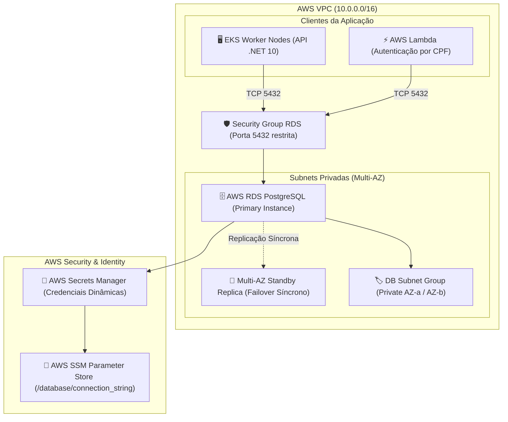
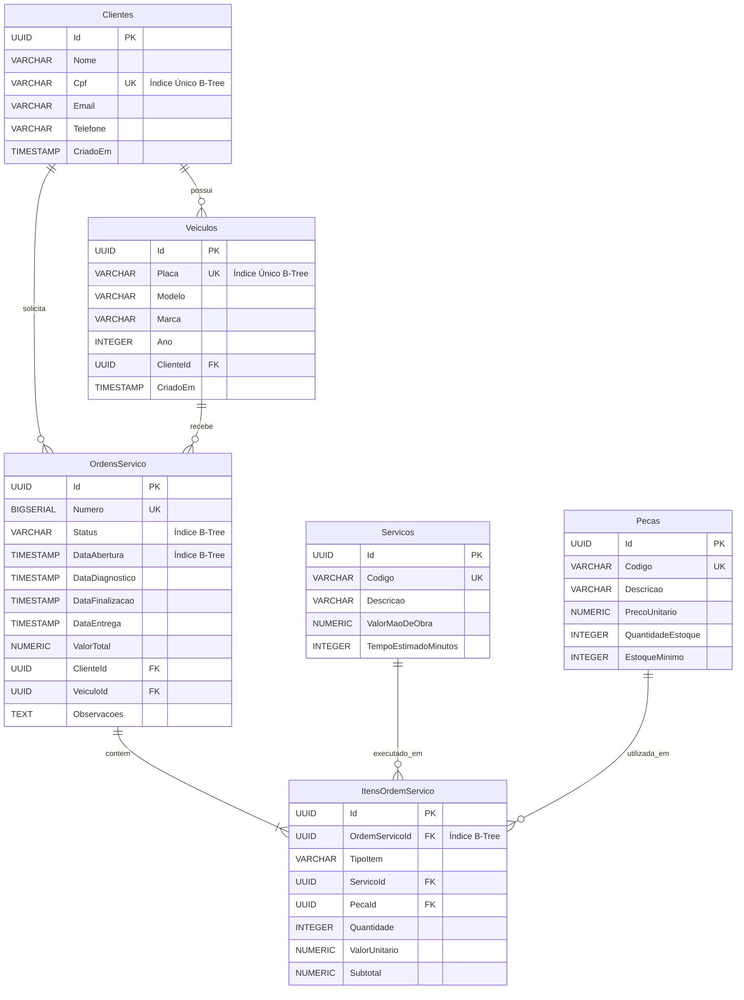

# FIAP Tech Challenge - Infraestrutura do Banco de Dados Gerenciado (Fase 3)

[](https://github.com/dvdalves/FIAP.Tech.Challenge.Infra.Database/actions/workflows/ci-cd.yml)

Repositório responsável pelo provisionamento como código (**IaC - Terraform**) da **infraestrutura de Banco de Dados Gerenciado (AWS RDS PostgreSQL)**, isolamento em subnets privadas, governança de credenciais via **AWS Secrets Manager**, scripts DDL de inicialização e documentação detalhada do modelo relacional, em conformidade com as exigências da **Fase 3 do Tech Challenge SOAT - FIAP**.

---

## 🧭 Sumário

1. [Propósito do Repositório](#1-propósito-do-repositório)
2. [Tecnologias Utilizadas](#2-tecnologias-utilizadas)
3. [Arquitetura de Nuvem e Isolamento de Rede](#3-arquitetura-de-nuvem-e-isolamento-de-rede)
4. [Justificativa Arquitetural: Escolha do PostgreSQL](#4-justificativa-arquitetural-escolha-do-postgresql)
5. [Modelagem Relacional e Diagrama ER](#5-modelagem-relacional-e-diagrama-er)
   - [Diagrama Entidade-Relacionamento (ERD)](#diagrama-entidade-relacionamento-erd)
   - [Dicionário de Dados e Relacionamentos](#dicionário-de-dados-e-relacionamentos)
   - [Otimizações de Índices e Performance](#otimizações-de-índices-e-performance)
6. [Passo a Passo de Provisionamento](#6-passo-a-passo-de-provisionamento)
   - [Pré-requisitos](#pré-requisitos)
   - [Execução via Terraform CLI](#execução-via-terraform-cli)
   - [Execução dos Scripts DDL e Seed](#execução-dos-scripts-ddl-e-seed)
7. [Governança e Rotação de Segredos](#7-governança-e-rotação-de-segredos)
8. [Esteira de CI/CD (GitHub Actions)](#8-esteira-de-cicd-github-actions)
9. [Tabela de Variáveis do Terraform](#9-tabela-de-variáveis-do-terraform)
10. [Segurança e Governança](#10-segurança-e-governança)

---

## 1. Propósito do Repositório

Garantir o isolamento, a alta disponibilidade, o backup e a governança de dados operacionais do sistema **SIAES (Oficina Mecânica)**. Este repositório provê:

- Provisionamento automatizado de uma instância gerenciada **PostgreSQL 16** via AWS RDS.
- Isolamento estrito de tráfego de banco em subnets privadas com bloqueio total de conexões públicas externas.
- Automação de senhas e geração da *connection string* de conexão com injeção segura no **AWS Secrets Manager** e **AWS SSM Parameter Store**.
- Scripts DDL versionados de schema (`01_schema.sql`) e carga de dados de teste (`02_seed.sql`).
- Documentação formal das decisões de modelagem relacional.

---

## 2. Tecnologias Utilizadas

| Tecnologia | Versão | Finalidade |
| :--- | :--- | :--- |
| **Terraform** | `>= 1.5.0` | Orquestração declarativa de infraestrutura como código (IaC) |
| **AWS RDS** | PostgreSQL 16.3 | Banco de dados relacional gerenciado corporativo |
| **AWS Secrets Manager** | Nativo | Armazenamento seguro e cifrado das credenciais administrativas do banco |
| **AWS SSM Parameter Store**| Nativo | Distribuição segura do Connection String para EKS e Lambda |
| **AWS KMS** | Nativo | Criptografia de dados em repouso (*encryption at rest*) com chaves gerenciadas |
| **PostgreSQL DDL / SQL** | ANSI SQL / pgSQL | Definição de tabelas, chaves primárias, estrangeiras e índices B-Tree |
| **GitHub Actions** | v4 | Pipeline automatizada de validação sintática, linting e deploy |

---

## 3. Arquitetura de Nuvem e Isolamento de Rede



---

## 4. Justificativa Arquitetural: Escolha do PostgreSQL

Para o domínio de uma **Oficina Mecânica com múltiplas unidades (SIAES)**, a escolha do **PostgreSQL** sobre bancos NoSQL e concorrentes relacionais baseou-se nos seguintes pilares arquiteturais:

### 1. Garantias ACID Estritas
Operações como a **baixa atômica de estoque de peças** durante o encerramento de ordens de serviço e o **cálculo e aprovação financeira de orçamentos** exigem isolamento transacional (*Read Committed / Serializable*) e durabilidade para evitar inconsistências contábeis e estoques negativos em cenários de concorrência.

### 2. Integridade Referencial e Modelo de Domínio
O negócio da oficina possui relações intrínsecas e bem estruturadas: um cliente possui veículos, ordens de serviço pertencem obrigatoriamente a um veículo e cliente, e os itens de OS referenciam serviços ou peças específicas. O PostgreSQL garante a consistência referencial no próprio motor de banco através de *Foreign Keys* com ações em cascata controladas.

### 3. Índices de Alto Desempenho e Tipos Avançados
- Suporte a identificadores únicos universais (**UUID v4**) como chaves primárias, impedindo ataques de enumeração (*IDOR*) e facilitando a geração descentralizada de IDs na aplicação.
- Índices B-Tree especializados em colunas de alta frequência de busca (`Cpf` do cliente para a Lambda de autenticação e `Placa` do veículo).
- Suporte a tipos JSONB caso haja necessidade futura de armazenar dados semiestruturados de telemetria veicular.

### 4. Alta Disponibilidade e Gerenciamento no AWS RDS
O AWS RDS oferece réplica síncrona Multi-AZ com failover automatizado em menos de 60 segundos, snapshots automáticos contínuos com recuperação ponto no tempo (*Point-in-Time Recovery - PITR*) de até 35 dias, e armazenamento elástico autoescalável (*Storage Auto-scaling*).

---

## 5. Modelagem Relacional e Diagrama ER

### Diagrama Entidade-Relacionamento (ERD)



### Dicionário de Dados e Relacionamentos

- **`Clientes`**: Armazena os proprietários dos veículos. O campo `Cpf` possui índice único e é a chave de entrada para o fluxo serverless de autenticação.
- **`Veiculos`**: Vinculados a um cliente proprietário. A chave natural `Placa` é única, prevenindo cadastros duplicados.
- **`Servicos`**: Catálogo pré-definido de intervenções e manutenções com tabela de mão de obra e tempo estimado.
- **`Pecas`**: Catálogo e controle de inventário físico da oficina, com alertas de estoque mínimo.
- **`OrdensServico`**: Agregado raiz operacional, controlando o fluxo completo de estados (`Recebida` -> `Diagnostico` -> `AguardandoAprovacao` -> `EmExecucao` -> `Finalizada` -> `Entregue`).
- **`ItensOrdemServico`**: Tabela associativa polimórfica que compõe as peças aplicadas e os serviços executados na OS.

### Otimizações de Índices e Performance
- `IX_Clientes_Cpf`: Índice único garantindo busca O(1) na rota `/auth/token` da AWS Lambda.
- `IX_Veiculos_Placa`: Índice único para busca ágil de histórico de veículos na recepção da oficina.
- `IX_OrdensServico_Status`: Acelera a filtragem do quadro operacional de serviços ativos.
- `IX_OrdensServico_ClienteId`: Otimiza a listagem de ordens de serviço por cliente autenticado.

---

## 6. Passo a Passo de Provisionamento

### Pré-requisitos
- [Terraform CLI](https://developer.hashicorp.com/terraform/downloads) instalado (versão >= 1.5.0).
- [AWS CLI](https://aws.amazon.com/cli/) instalado e autenticado.
- Utilitário `psql` para execução manual dos scripts SQL (opcional, pois a aplicação EF Core executa `EnsureCreated`).

### Execução via Terraform CLI

```bash
# 1. Copiar as variáveis de exemplo
cp terraform.tfvars.example terraform.tfvars

# 2. Ajustar os IDs de rede no terraform.tfvars (VPC e Subnets Privadas do cluster)
# Caso deixe vazio, o Terraform utilizará a VPC padrão para fins de testes

# 3. Inicializar provedores
terraform init

# 4. Planejar a criação
terraform plan -out=tfplan

# 5. Aplicar o provisionamento
terraform apply tfplan
```

### Execução dos Scripts DDL e Seed

Os scripts SQL versionados estão localizados na pasta [`sql/`](sql/):

```bash
# Obter o endpoint gerado
DB_HOST=$(terraform output -raw db_address)

# Aplicar o schema
psql -h $DB_HOST -U oficina_admin -d oficina_db -f sql/01_schema.sql

# Aplicar a carga inicial de teste
psql -h $DB_HOST -U oficina_admin -d oficina_db -f sql/02_seed.sql
```

---

## 7. Governança e Rotação de Segredos

O repositório adota as melhores práticas de segurança de nuvem:
- Nenhuma senha plana é mantida em código ou controle de versão.
- O recurso `random_password` gera automaticamente uma credencial com alta entropia criptográfica.
- As credenciais são persistidas no **AWS Secrets Manager** (`oficina/production/database/credentials`), permitindo rotação automatizada sem indisponibilidade.
- A aplicação consome o parâmetro via **AWS SSM Parameter Store** cifrado com AWS KMS.

---

## 8. Esteira de CI/CD (GitHub Actions)

A pipeline declarada em [`.github/workflows/ci-cd.yml`](.github/workflows/ci-cd.yml) realiza:
1. **`terraform-validate`**: Validação de sintaxe e lint de código (`terraform fmt -check` e `terraform validate`).
2. **`terraform-plan`**: Execução não destrutiva de plano em pull requests.
3. **`terraform-apply`**: Deploy automático de alterações de banco na branch `main`/`master`.

---

## 9. Tabela de Variáveis do Terraform

| Variável | Tipo | Padrão | Descrição |
| :--- | :--- | :--- | :--- |
| `aws_region` | `string` | `"us-east-1"` | Região AWS do RDS |
| `db_identifier` | `string` | `"oficina-postgres-db"` | Identificador da instância RDS |
| `db_name` | `string` | `"oficina_db"` | Nome da base de dados relacional |
| `db_username` | `string` | `"oficina_admin"` | Usuário administrador |
| `db_instance_class` | `string` | `"db.t4g.micro"` | Tipo e dimensionamento de hardware |
| `allocated_storage` | `number` | `20` | Tamanho inicial de disco em GiB |
| `max_allocated_storage`| `number` | `50` | Limite do storage autoscaling |
| `engine_version` | `string` | `"16.3"` | Versão oficial do PostgreSQL |
| `backup_retention_period` | `number` | `7` | Retenção de backups diários |
| `multi_az` | `bool` | `false` | Habilita réplica síncrona Multi-AZ |

---

## 10. Segurança e Governança

- **Isolamento de Rede**: O parâmetro `publicly_accessible = false` impede qualquer conexão pública ao RDS.
- **Proteção de Branch**: As branches `main` e `master` exigem abertura de Pull Request e aprovação das esteiras automáticas.
- **Acesso Docente**: O usuário examinador `soat-architecture` possui permissão configurada para inspeção do repositório.
